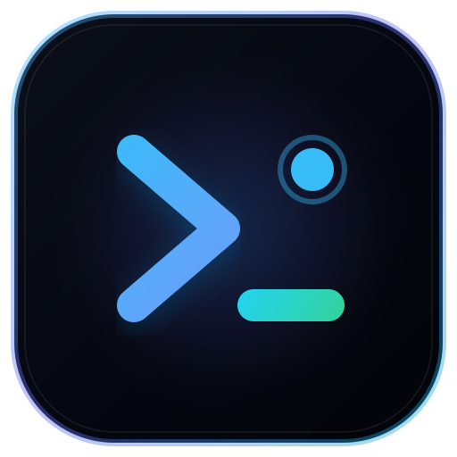

#  OpenSourceHQ

[](https://org.nstsdc.org)
[](https://nextjs.org/)
[](https://www.typescriptlang.org/)
[](https://www.postgresql.org/)
[](https://www.prisma.io/)
[](https://k3s.io/)

**Enterprise-grade mentorship & fellowship management platform for open-source organizations, cohorts, mentors, and mentees.**

---

## 🌐 Live Deployment

OpenSourceHQ is deployed to high-availability bare-metal Kubernetes (K3s) with Traefik Ingress routing and Cloudflare Edge:

* **Production URL**: [https://org.nstsdc.org](https://org.nstsdc.org)
* **Status**: 🟢 **Operational**
* **Health Check**: [https://org.nstsdc.org/api/health](https://org.nstsdc.org/api/health)

---

## ✨ Features at a Glance

* **🏢 Multi-Tenant Organization Isolation**: Strict organizational scoping with role-based access control (`SUPER_ADMIN`, `ORG_ADMIN`, `MENTOR`, `MENTEE`, `GUEST`).
* **👥 Cohort & Fellowship Management**: Program lifecycles, structured cohort assignments, mentor pairings, and milestone trackers.
* **📝 Daily Engineering Logs & Streaks**: Structured log submissions with automated streak tracking, PR artifact linking, and blocker triage.
* **🐙 GitHub App Telemetry & Ingestion**:
  * HMAC-verified webhook ingestion (`push`, `pull_request`, `issues`, `pull_request_review`).
  * Real-time commit, PR, and review metrics with zero user personal access token requirements.
  * Public repository synchronization jobs with deduplicated telemetry feeds.
* **📊 Analytics & Activity Visualizations**: Organization-wide velocity, streak leaderboards, blocker resolution tracking, and cohort comparison metrics.
* **🔒 Enterprise Security**: Encrypted-at-rest secrets, session-based authentication with CSRF protections, strict tenant boundary enforcement, and immutable audit logs.
* **🌓 Accessible Modern UI**: High-contrast dark and light modes, responsive desktop & mobile views, accessible keyboard navigation.

---

## 🏛️ System Architecture

```mermaid
flowchart TD
    CF[Cloudflare Edge / DNS] -->|TLS HTTPS| TR[Traefik Ingress Controller]
    TR -->|HTTP / Service| APP[Next.js 15 Standalone Service]
    
    subgraph "Kubernetes Cluster (nst-events)"
        APP --> DB[(PostgreSQL 16 + Longhorn PVC)]
        CRON[Sync CronJob (30m)] -->|Bearer Auth| APP
    end

    subgraph "External Integrations"
        GH[GitHub Webhooks & REST API] -->|HMAC Webhook| APP
        MEMBER[Contributor Repositories] -.->|Sync Telemetry| APP
    end
```

---

## 🚀 Quickstart

### Prerequisites
* Node.js `>= 20.x`
* `pnpm` `>= 9.x`
* Docker or PostgreSQL 16 instance

### 1. Clone & Install
```bash
git clone https://github.com/sohamdhande/OpenSourceHQ.git
cd OpenSourceHQ
pnpm install
```

### 2. Configure Environment
```bash
cp .env.example .env
# Configure DATABASE_URL and AUTH_SECRET in .env
```

### 3. Initialize Database & Seed
```bash
# Push schema to database
pnpm prisma db push

# Seed realistic demo data
pnpm db:seed
```

### 4. Run Development Server
```bash
pnpm dev
# App will be accessible at http://localhost:3000
```

---

## 🔑 Demo Accounts

All pre-seeded local and cluster accounts use default password: `password123`

| Role | Email | Description |
| :--- | :--- | :--- |
| **Super Admin** | `admin@opensourcehq.local` | Full cross-organization control and system audit logs |
| **Org Admin** | `sarah.admin@nstsdc.org` | Organization settings, cohort creation, and mentor assignment |
| **Mentor** | `alex.mentor@nstsdc.org` | Mentee oversight, task review, and daily log approvals |
| **Mentee** | `devon.mentee@nstsdc.org` | Engineering logs, task submissions, and GitHub timeline |

---

## 🚢 Kubernetes Deployment

Production manifests are located in `k8s/`:

```bash
kubectl apply -f k8s/01-config-and-secret.example.yaml
kubectl apply -f k8s/02-postgres.yaml
kubectl apply -f k8s/04-app-deployment.yaml
kubectl apply -f k8s/05-cronjob-github-sync.yaml
kubectl apply -f k8s/06-ingress.yaml
```

Container images are published automatically via GitHub Actions to:
`ghcr.io/sohamdhande/opensourcehq:<git-sha>`

---

## 📜 License
Licensed under the [MIT License](LICENSE).
