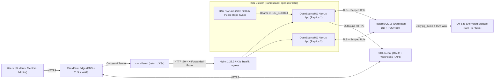

# Recommended Production Architecture — OpenSourceHQ

**Target Domain:** `https://org.nstsdc.org`  
**Based on Verified Infrastructure:** Bare-metal `nst-n1` (K3s `v1.36.5+k3s1`, Nginx `1.28.3`, `cloudflared 2026.11.0`, PostgreSQL `18.6`)

---

## Architecture Diagram

---

## Deployment Method Recommendation

1. **Primary Recommendation (K3s Manifests / Helm in Dedicated Namespace):** Since K3s `v1.36.5+k3s1` and Helm `v4.0.4` are already active, deploy OpenSourceHQ as a **2-replica Kubernetes `Deployment`** in a dedicated `opensourcehq` namespace with a K3s `CronJob` for `/api/cron/github-sync`, backed by a dedicated PostgreSQL instance (either a K3s PostgreSQL StatefulSet or `postgresql@18-main` with CNI access) and routed via `cloudflared` -> Nginx/Traefik.
2. **Fallback (Host-Level Systemd + Node 22):** If K3s namespace access cannot be provisioned quickly by college IT, run OpenSourceHQ directly on `nst-n1` under a dedicated locked-down system user (`opensourcehq`) with `systemd`, `node v22.22.1`, local `postgresql@18-main` (`127.0.0.1:5432`), and `nginx` -> `cloudflared`.

